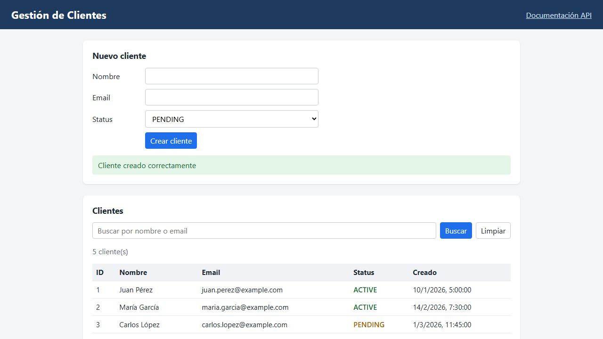

# Parte 5 — Automatización E2E con Playwright

> **Documento generado automáticamente** por `scripts/generate-e2e-evidence.js` a partir del reporte JSON de
> Playwright. No editar a mano: se regenera con `npm run test:e2e`.

## 1. Ejecución

| Dato | Valor |
|---|---|
| Fecha | 2026-10-15 23:53:09 UTC |
| Duración | 8.5 s |
| Navegador | Chromium (Playwright 1.64.1) |
| Resultado | 4 tests: **3 pasan**, **1 fallan** |
| Evidencia versionada | `e2e/evidence/` (screenshot y trace de los tests fallidos, `summary.json`) |
| Reporte HTML (local) | `playwright-report/` — abrir con `npm run report:e2e` |

## 2. Resultados

| TC-ID | Test | Tags | Resultado | Duración |
|---|---|---|:---:|---:|
| TC-19 | TC-19 alta desde la UI: el cliente aparece en la búsqueda con su status y existe en la API | `@positive` `@e2e` | PASS | 0.6 s |
| TC-21 | TC-21 búsqueda sin resultados: muestra el estado vacío y al limpiar vuelve el listado | `@negative` | PASS | 0.4 s |
| TC-20 | TC-20 alta con email duplicado: la UI muestra el error que devuelve la API | `@negative` `@known-risk` | **FAIL** | 5.6 s |
| TC-22 | TC-22 status cambiado por API se muestra actualizado en la UI | `@integration` | PASS | 0.4 s |

Pasos de cada test (`test.step`):

- **TC-19** (tests/e2e/customers.spec.ts:5): ✅ Abrir la aplicación → ✅ Crear el cliente desde el formulario → ✅ Buscarlo por nombre → ✅ Buscarlo por email y validar la fila y el status → ✅ Verificar por API que el cliente existe con los mismos datos
- **TC-21** (tests/e2e/customers.spec.ts:46): ✅ Buscar un término sin coincidencias → ✅ Limpiar la búsqueda
- **TC-20** (tests/e2e/customers.spec.ts:68): ✅ La API rechaza el alta con 409 Conflict → ❌ La UI informa el error y no muestra éxito
- **TC-22** (tests/e2e/customers.spec.ts:111): ✅ Cambiar el status por API → ✅ Recargar y validar el status en la tabla

## 3. Fallos

### TC-20 alta con email duplicado: la UI muestra el error que devuelve la API

**Riesgo asociado:** R-04 / TC-20: la UI informa éxito sin verificar la respuesta del POST

| Verificación | Valor observado |
|---|---|
| Respuesta de la API | `POST /customers → 409 EMAIL_ALREADY_EXISTS` |
| Mensaje en la UI | `data-status="success" · texto="Cliente creado correctamente" (respuesta HTTP 409)` |
| Paso: La API rechaza el alta con 409 Conflict | ✅ cumple |
| Paso: La UI informa el error y no muestra éxito | ❌ no cumple |

La API rechazó el alta correctamente (409), pero la interfaz mostró el mensaje de éxito: el defecto está en el
frontend, que no verifica el resultado de la petición antes de informar al usuario.

**Assertion que falló:**

```text
Error: La UI debe reflejar el error de la API

expect(locator).toHaveAttribute(expected) failed

Locator:  getByTestId('create-message')
Expected: "error"
Received: "success"
Timeout:  5000ms

Call log:
  - La UI debe reflejar el error de la API getByTestId('create-message') with timeout 5000ms
  - waiting for getByTestId('create-message')
    14 × locator resolved to <div role="status" aria-live="polite" id="create-message" data-status="success" class="message success" data-testid="create-message">Cliente creado correctamente</div>
       - unexpected value "success"


   99 |           description: `data-status="${shown}" · texto="${text?.trim()}" (respuesta HTTP ${response.status()})`,
  100 |         });
> 101 |         await expect(customersPage.createMessage, 'La UI debe reflejar el error de la API').toHaveAttribute('data-status', 'error');
      |                                                                                             ^
  102 |         await expect(customersPage.createMessage).not.toHaveText('Cliente creado correctamente');
  103 |       });
  104 |
```

**Evidencia:**

- Screenshot: [`e2e/evidence/TC-20/screenshot.png`](../e2e/evidence/TC-20/screenshot.png)

  

- Trace: [`e2e/evidence/TC-20/trace.zip`](../e2e/evidence/TC-20/trace.zip)
- El video del fallo queda solo en el reporte local (`test-results/`), no se versiona.

## 4. Cómo abrir el trace

El trace contiene cada acción, el DOM antes y después, las peticiones de red y la consola del navegador.

- **En el navegador, sin instalar nada:** abrir <https://trace.playwright.dev> y arrastrar el archivo `trace.zip`.
  El archivo se procesa localmente en el navegador; no se sube a ningún servidor.
- **Desde el repo:** `npx playwright show-trace e2e/evidence/TC-20/trace.zip`.

## 5. Comandos

| Script | Uso |
|---|---|
| `npm run test:e2e` | **Comando de referencia.** Ejecuta todos los tests, copia la evidencia y regenera este documento. Termina con código de salida 1 mientras haya fallos, incluido el riesgo conocido TC-20. |
| `npm run test:e2e:stable` | **Para CI.** Excluye los tests con tag `@known-risk` (`--grep-invert @known-risk`) para que un riesgo ya reportado no bloquee el pipeline. No reemplaza a `test:e2e`: el riesgo sigue abierto y se verifica con el comando de referencia. |
| `npm run test:e2e:headed` | Igual que `test:e2e` pero con el navegador visible (sin regenerar la evidencia). |
| `npm run report:e2e` | Abre el reporte HTML de la última ejecución. |

## 6. Diseño

| Aspecto | Decisión |
|---|---|
| Estructura | Page Object `tests/pages/CustomersPage.ts`; fixtures en `tests/fixtures/test-fixtures.ts` (`customersPage`, `api` y reset automático del mock antes de cada test); cliente API en `tests/support/customers-api.ts`. |
| Selectores | Solo `data-testid` del frontend (`getByTestId`). Sin XPath ni selectores por texto. |
| Esperas | Cada acción espera la respuesta HTTP que dispara (`waitForResponse`); las verificaciones usan web-first assertions. Sin `waitForTimeout`. |
| Independencia | Cada test arranca con los 5 clientes semilla (`POST /__test/reset`). `workers: 1` porque el mock tiene un único estado en memoria. |
| Evidencia | `screenshot: only-on-failure`, `video` y `trace: retain-on-failure`; reportes `list`, `html` y `json`. `retries: 0` para que un fallo real no se marque como inestable. |
| Test que falla | TC-20 es un test normal con tag `@known-risk` y annotation `risk`. No se usa `test.fail()`, que lo reportaría como exitoso y no guardaría evidencia. |
| Servidor | `webServer` levanta el mock con `npm --prefix mock-app start` solo si no está corriendo. |

## 7. Riesgos observados

| ID | Riesgo | Severidad | Detalle | Mitigación en las pruebas |
|---|---|:---:|---|---|
| R-04 | La UI informa éxito sin verificar la respuesta del POST | Alta | Ver TC-20 en la sección 3. | — (el test lo detecta y falla) |
| R-08 | Carrera entre respuestas de la lista | Baja | El frontend no cancela ni ordena las peticiones `GET /customers`. Tras un alta dispara una recarga sin filtro; si el usuario busca enseguida, esa recarga y la búsqueda quedan en vuelo a la vez y, si la recarga llega después, la tabla muestra todos los clientes aunque haya un término de búsqueda escrito. | `CustomersPage.createCustomer` espera la recarga posterior al alta antes de continuar, para que los tests no sean inestables. Recomendación al equipo: cancelar la petición anterior (`AbortController`) o descartar respuestas desactualizadas. |
