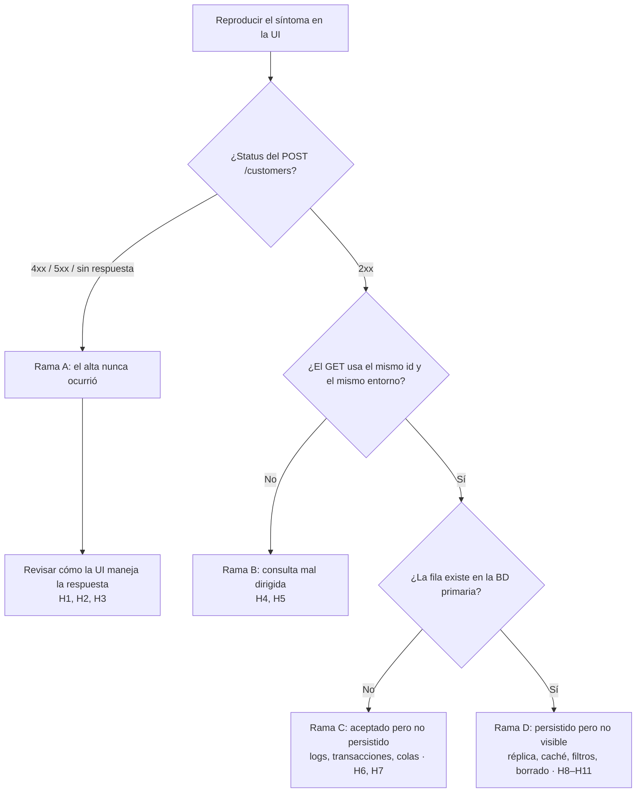

# Parte 6 — Investigación de bug

**Síntoma reportado:** el frontend muestra "Cliente creado correctamente", pero al consultar después
`GET /customers/{id}` el cliente no existe.

---

## 1. Resumen

| | |
|---|---|
| **Causa raíz (en este caso)** | El `POST /customers` respondió **409 Conflict** (email duplicado) y el frontend mostró el mensaje de éxito igualmente, sin evaluar el status de la respuesta. El cliente nunca se creó. |
| **Capa** | Frontend (`mock-app/public/app.js`, manejador `submit` del formulario de alta). |
| **Observación decisiva** | El request HTTP: un solo vistazo a la pestaña de red mostró `POST → 409` seguido del mensaje de éxito. |
| **Descartado** | Backend, persistencia y lectura: la API respondió correctamente y la BD no tiene la fila porque nunca debió tenerla. |

---

## 2. Orden de investigación y por qué

Se avanza **de lo más barato y observable a lo más profundo**. Cada paso usa evidencia que cuesta poco obtener y
descarta ramas enteras antes de pasar a capas que requieren accesos, logs o consultas a producción.

| # | Capa | Por qué en este orden |
|:---:|---|---|
| 1 | Frontend | Se reproduce en minutos, sin accesos especiales. Confirma que el síntoma existe y cómo se presenta. |
| 2 | Request HTTP | **Es la observación que divide el árbol en dos.** El status y el body del `POST` dicen si el alta fue aceptada o no. |
| 3 | Backend | Repetir el request contra la API, sin la UI, aísla si el problema es del cliente o del servidor. |
| 4 | Logs | Explican *por qué* el backend se comportó así (excepciones, rollbacks, workers). Requieren acceso y correlación. |
| 5 | Base de datos | Es la verdad final sobre la persistencia, pero la más costosa y delicada (accesos, réplicas, datos reales). |

---

## 3. Árbol de hipótesis

| Rama | ID | Hipótesis | Señal que la confirma | Señal que la descarta |
|---|---|---|---|---|
| **A. El alta nunca ocurrió** | H1 | El `POST` respondió error (400/409/500) y la UI no evalúa la respuesta | `POST` con status no 2xx en la pestaña de red y aun así mensaje de éxito | `POST` con 2xx |
| | H2 | El request nunca llegó (red, CORS, timeout) o la UI muestra éxito antes de tener la respuesta (UI optimista) | `POST` ausente, fallido o cancelado; mensaje visible antes de la respuesta | `POST` completo con respuesta |
| | H3 | Doble envío o request abortado por navegación | Dos `POST`, o uno en estado *canceled* | Un único `POST` completo |
| **B. Ocurrió, pero se consulta mal** | H4 | El `GET` usa un id distinto al devuelto por el `POST` (otro campo, `Location` mal leído, string vs number) | El id del body / `Location` del `POST` no coincide con el del `GET` | Mismo id en ambos requests |
| | H5 | El `GET` apunta a otro entorno, `baseURL`, tenant o cabecera | Hosts o cabeceras de tenant distintos entre los dos requests | Mismo host y cabeceras |
| **C. Aceptado, pero no persistió** | H6 | Transacción sin commit o rollback posterior (excepción después de responder) | `POST` 2xx, error o rollback en logs, fila ausente en la primaria | Fila presente en la primaria |
| | H7 | Persistencia asíncrona (cola / worker) que falló tras un 201/202 | Mensaje en la cola o DLQ, error en el worker | Persistencia síncrona o worker sin errores |
| **D. Persistió, pero la lectura no lo ve** | H8 | Lectura desde réplica con lag | Fila en la primaria y no en la réplica; un reintento posterior la encuentra | Primaria y réplica coinciden |
| | H9 | Caché (CDN, API o 404 cacheado) | Cabeceras `Age` / `X-Cache`; sin caché se encuentra | Respuesta sin caché |
| | H10 | Filtros: soft delete, tenant, scope de permisos | Fila con `deleted_at`, otro `tenant_id` u otro owner | Fila sin filtros que la excluyan |
| | H11 | Otro proceso la borró después (job de limpieza, reset concurrente de otra ejecución de pruebas) | Alta y luego borrado en auditoría/binlog; coincide con la hora de un job | Sin borrados registrados |

---

## 4. Proceso por capa

### 4.1 Frontend

| | |
|---|---|
| **Qué se revisa** | Reproducir el flujo con datos concretos; anotar email, hora y entorno. Consola del navegador (errores JS, promesas rechazadas). |
| **Herramienta** | Navegador + DevTools (Console); Playwright para reproducirlo de forma repetible. |
| **Confirma / descarta** | Confirma el síntoma. Errores en consola apuntan a H2. Si no se reproduce, revisar datos y entorno del reporte original (H5). |
| **Siguiente paso** | Repetir con la pestaña de red abierta. |

### 4.2 Request HTTP

| | |
|---|---|
| **Qué se revisa** | Status, body y cabeceras del `POST /customers` (incluido `Location`); host y id del `GET /customers/{id}` posterior. |
| **Herramienta** | DevTools (Network), exportación HAR, trace de Playwright. |
| **Confirma / descarta** | Status no 2xx → rama A (H1–H3). 2xx con id distinto o host distinto → rama B (H4, H5). 2xx con mismo id y host → ramas C/D. |
| **Siguiente paso** | Rama A: revisar el código del frontend que maneja la respuesta. Ramas C/D: ir al backend. |

### 4.3 Backend

| | |
|---|---|
| **Qué se revisa** | Repetir el mismo `POST` y luego el `GET` directamente contra la API, en el mismo entorno, sin la UI. |
| **Herramienta** | Postman / Newman, cURL (`postman/curl-commands.md`). |
| **Confirma / descarta** | Si por API el `GET` encuentra el cliente, el problema está en el cliente (rama B). Si tampoco lo encuentra, está en backend o datos (ramas C/D). |
| **Siguiente paso** | Buscar el request en los logs. |

### 4.4 Logs

| | |
|---|---|
| **Qué se revisa** | El request del alta por correlation id / timestamp: excepciones, rollbacks, mensajes encolados, errores de workers, a qué réplica se dirigió la lectura. |
| **Herramienta** | Logs de aplicación, APM, logs de la cola, logs de la BD (error log, binlog / auditoría). |
| **Confirma / descarta** | Rollback o excepción tras responder → H6. Error de worker → H7. Lectura enrutada a réplica → H8. Borrado posterior → H11. |
| **Siguiente paso** | Verificar en la BD. |

### 4.5 Base de datos

| | |
|---|---|
| **Qué se revisa** | Buscar el cliente por email (sin distinguir mayúsculas) y por id en la **primaria** y en la réplica; revisar `deleted_at`, `tenant_id`, auditoría. |
| **Herramienta** | Cliente SQL con acceso de solo lectura; consultas de `sql/03-validation-queries.sql` (Q1 localizar por email, Q4 últimos creados). |
| **Confirma / descarta** | Fila ausente en primaria → H6/H7 (o rama A). Presente en primaria y no en réplica → H8. Presente con filtros → H10. |
| **Siguiente paso** | Documentar causa raíz, reproducción mínima y evidencia; abrir el defecto en la capa responsable. |

---

## 5. Aplicación al caso de este assessment

| Paso | Evidencia existente | Resultado |
|---|---|---|
| 1. Frontend | `e2e/evidence/TC-20/screenshot.png` | Al dar de alta un email ya registrado (`maria.garcia@example.com`), la UI muestra "Cliente creado correctamente" mientras la tabla sigue con 5 clientes. **Síntoma reproducido.** |
| 2. Request HTTP | `e2e/evidence/TC-20/trace.zip` (pestaña Network) y `e2e/evidence/summary.json` | La red registra `POST /customers → 409` seguido de `GET /customers → 200` (recarga de la lista). Anotaciones: `api-response` = `POST /customers → 409 EMAIL_ALREADY_EXISTS`; `ui-message` = `data-status="success" · texto="Cliente creado correctamente" (respuesta HTTP 409)`. **Rama A.** Se descartan las ramas B, C y D. |
| 3. Backend | `docs/02-api-testing.md`, prueba #6 (TC-08) | Por API, sin la UI, un email duplicado responde **409 `EMAIL_ALREADY_EXISTS`** de forma consistente. El backend cumple el contrato. |
| 4. Logs | — | La aplicación de referencia solo registra errores 500; los 4xx no quedan en logs. La pestaña de red del trace cumple el papel de log del request. En un entorno real se buscaría por correlation id. |
| 5. Base de datos | `sql/02-data.sql` y salida de Q4 en `sql/evidence/03-validation-queries.txt` | En la ejecución de la Parte 4, el alta duplicada del paso 03 de la colección ("QA Duplicado", rechazada con 409) **no aparece** como fila: solo existen los ids 6 y 7. Consistente con el 409: no hay fila que buscar. |

**Causa raíz:** el manejador `submit` del formulario en `mock-app/public/app.js` muestra el mensaje de éxito sin evaluar
`res.ok` ni el status de la respuesta. Además resetea el formulario y recarga la lista, lo que hace el error invisible
para el usuario.

**Por qué el `GET /customers/{id}` no encuentra el cliente:** la respuesta 409 no incluye un id; cualquier id que se use
después no corresponde a un cliente nuevo, porque nunca se creó.

**Reproducción mínima:** abrir `/`, completar nombre y el email `maria.garcia@example.com`, pulsar "Crear cliente".
Resultado: `POST 409` + mensaje de éxito. Automatizada en `tests/e2e/customers.spec.ts` (TC-20).

---

## 6. Prevención

| Control | Qué evita | Estado en este repo |
|---|---|---|
| Test unitario del manejo de respuestas del alta (2xx → éxito; 4xx/5xx → mensaje de error de la API) | Que la UI vuelva a ignorar el status | Pendiente (recomendado) |
| E2E TC-20 en CI con `npm run test:e2e`; al corregir el defecto, quitar el tag `@known-risk` para que forme parte de `test:e2e:stable` | Regresión del defecto en la UI | Test existente, hoy falla |
| E2E que verifica por API (GET por id) cada alta hecha desde la UI | Éxitos "falsos" en cualquier capa | Cubierto por TC-19 |
| Pruebas de contrato (respuestas reales vs. `/openapi.json`) | Que la UI se programe contra códigos documentados erróneos (por ejemplo, 200 vs. 201) | Evidencia en Parte 2 (R3) y Parte 3 |
| Correlation id propagado del frontend a la API y a los logs; registrar también los 4xx | Investigaciones sin trazabilidad (paso 4) | Pendiente |
| Telemetría de errores del frontend y monitoreo de la tasa de 4xx del alta | Que un fallo silencioso pase desapercibido en producción | Pendiente |
| Checklist de code review: "toda llamada `fetch` evalúa `res.ok` y muestra el error" | Repetir el patrón en otras pantallas | Pendiente |
| Para las otras ramas: lectura desde primaria tras escribir (read-your-writes), entorno visible en la UI o en un endpoint de health, datos de prueba aislados por ejecución | H5, H8, H11 | Pendiente |
